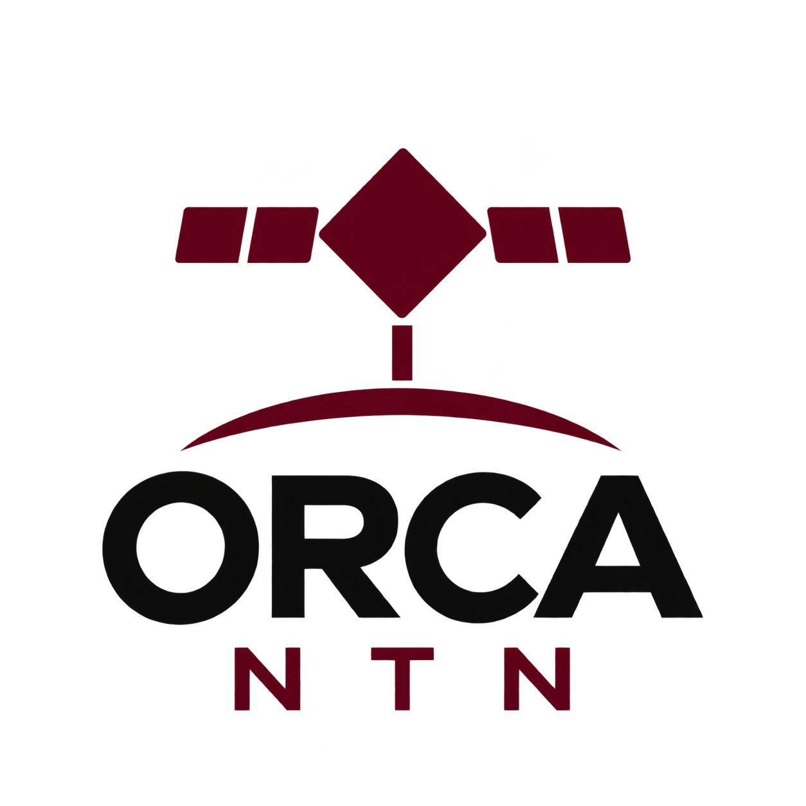
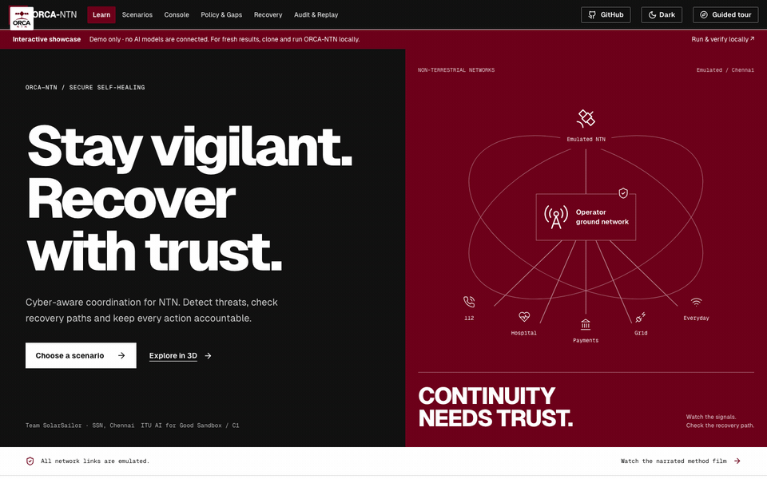
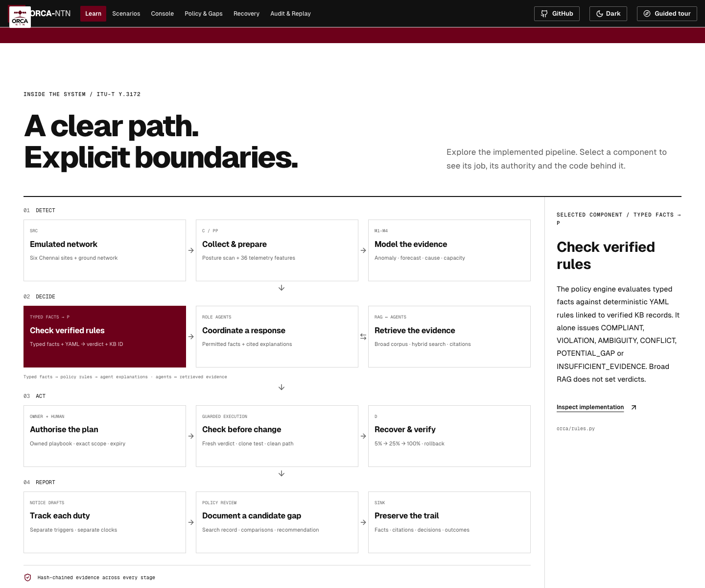
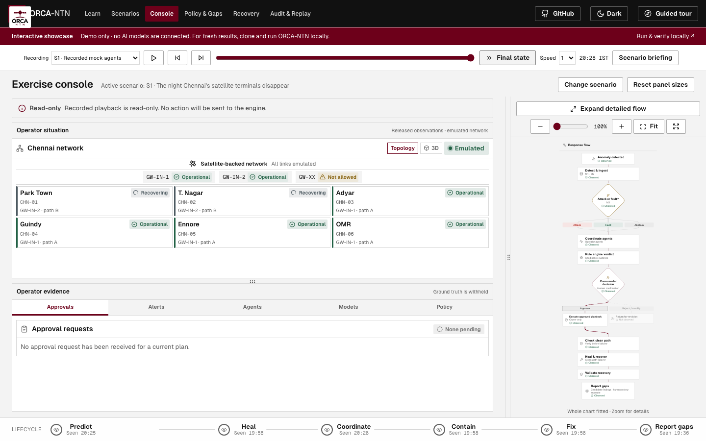
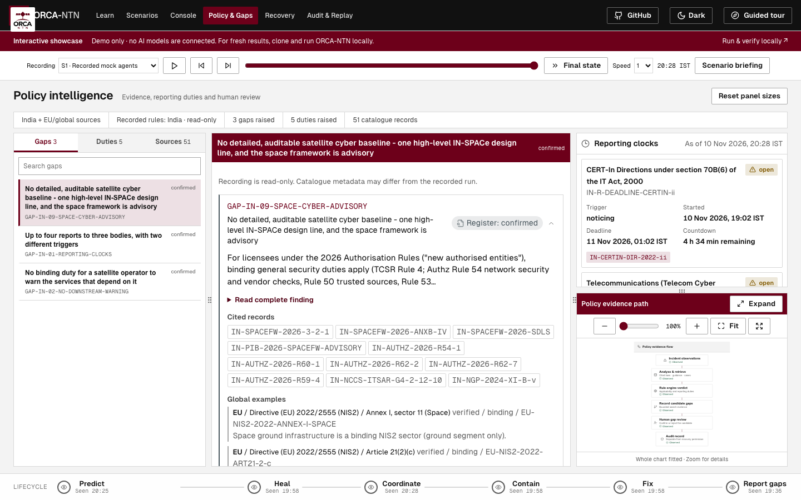

<p align="center">
  
</p>

<h1 align="center">ORCA-NTN</h1>
<p align="center"><strong>Cyber-aware coordination for NTN.</strong><br/>Team <strong>SolarSailor</strong> · SSN, Chennai · ITU AI for Good Sandbox Hackathon UAE</p>

<p align="center">
  <a href="https://orca-demo-blush.vercel.app"><strong>Explore the demo ↗</strong></a> &nbsp;·&nbsp;
  <a href="https://github.com/CharanVelavan/ORCA#quick-start">Run locally</a> &nbsp;·&nbsp;
  <a href="https://github.com/CharanVelavan/ORCA/blob/main/docs/JUDGE_REPRODUCIBILITY.md">Reproduce results</a> &nbsp;·&nbsp;
  <a href="https://huggingface.co/CharanVelavan/orca-ntn-qwen3.6-35b-a3b-ft-gguf">Fine-tuned Qwen</a>
</p>

<p align="center">
  
  
  
</p>

> **Hosted demo only:** no AI models are connected to the website. It plays recorded emulated
> scenarios. For fresh inference and reproducible results, clone and run the
> [full ORCA-NTN implementation](https://github.com/CharanVelavan/ORCA).

ORCA-NTN—**Orchestrated Response and Coordination Agents**—demonstrates secure self-healing and
cyber incident coordination for an **emulated** satellite-backed Chennai network. It addresses
problem **C1**: recognise an incident, recover over a trusted path, coordinate the responsible parties
and retain evidence for policy review.

**Models detect. Agents coordinate. Code decides. Humans approve.**

## Explore before installing



*An animated overview of the hosted recorded showcase—not a fresh model-performance test.*

| Open the hosted showcase | Run the implementation locally |
|---|---|
| Learn the architecture, choose a scenario, play/pause/seek recorded evidence. | Start fresh emulated exercises, connect your model endpoint, inspect new evidence and evaluate the models/RAG. |
| No setup and no live AI connection. | Python quick-start scripts; optional Qwen and vector retrieval setup. |

## Inside ORCA-NTN



| Component | Its job |
|---|---|
| **M1–M4** | Detect anomalies, forecast failure windows, distinguish fault/attack and allocate capacity. |
| **Role agents + retrieval** | Investigate permitted evidence, retrieve sources and coordinate recommendations. |
| **Deterministic policy engine** | Produce one of six cited verdicts from typed facts and YAML conditions. |
| **Guarded recovery** | Enforce ownership, clone tests, approvals, staged rollout and clean-path/re-attack checks. |
| **Audit and human review** | Preserve the response trail; keep candidate gaps separate from confirmed findings. |

| Recorded Console | Policy evidence |
|---|---|
|  |  |

<a id="quick-start"></a>

## Run it locally

Install **64-bit Python 3.12** and Git. On macOS, install the LightGBM runtime with
`brew install libomp`; on Debian/Ubuntu, install `libgomp1`. Clone this repository, then choose your
platform:

```bash
git clone https://github.com/CharanVelavan/ORCA.git
cd ORCA
./quickstart.sh
```

On Windows PowerShell or Command Prompt:

```powershell
git clone https://github.com/CharanVelavan/ORCA.git
cd ORCA
.\quickstart.bat
```

Open **http://127.0.0.1:8060/**. The launcher prepares `.venv-judge`, installs the hash-checked `requirements-judge.lock`
and starts the mock-agent dashboard. The built website and narrated film are included. **Node.js,
Qwen weights, a GPU and the vector corpus are not required for this default path.** Installation
needs internet; the installed mock exercise does not call an external model. First startup trains
M1–M3 when the ignored model cache is missing, so allow several minutes.

In **Scenarios**, select an exercise, read its briefing and press **Start exercise**. A successful
backend start opens **Console** automatically. Preview selection preserves the current run.

- [Full reproducibility guide](docs/JUDGE_REPRODUCIBILITY.md): prerequisites, hardware planning,
  verified downloads, local/remote model servers, RAG restoration and troubleshooting.
- [Windows setup](docs/JUDGE_WINDOWS.md): native launcher, environment paths and platform limits.
- [Website guide](guide.md): screen-by-screen controls and evidence boundaries.
- [Judge demo path](docs/DEMO.md) and [run/test commands](docs/RUN.md).
- [Verification record](docs/JUDGE_VERIFICATION.md): actual fresh-install, retrieval and live-run
  checks, with their configuration and remaining limits.

To inspect setup without installation or launch, use `./quickstart.sh --dry-run`. To check an
already prepared environment, use `./quickstart.sh --check`. The Windows launcher accepts the same
options. Manual virtual-environment commands are in the reproducibility guide.

## Choose the right mode

| Mode | What happens | Optional infrastructure |
|---|---|---|
| **Mock simulation** | Fresh simulator, M1–M4, rules and deterministic agent stand-ins. | None beyond the installed Python environment. |
| **Live endpoint / Qwen** | Fresh simulator and actual tool-calling requests to a configured model. | A running compatible model endpoint, local or remote. |
| **Recorded replay** | Existing observations replay across Console, Policy, Recovery and Audit. | No new model inference; a recording must exist. |

The mode selector prepares the next run. The source label identifies the current run. A failed live
request is not silently replaced with a mock response. Cached model-call replay is a separate
configuration and is labelled separately. All satellite and terrestrial links remain emulated.

For a running endpoint:

```bash
./quickstart.sh --mode live --endpoint http://127.0.0.1:8000/v1 --model-id "your-exact-served-model-id"
```

Use the exact ID from the endpoint's `/v1/models`, then run the dashboard's **Model connection**
tool-compatibility test. The launcher checks discovery, not full tool behaviour. Credentials belong
in **Model connection** or `LLM_API_KEY`, not command arguments or source control. The Python CLI
does not automatically load `.env`.

## Optional published artifacts

| Artifact | Public location | Download and scope |
|---|---|---|
| Tuned Qwen3.6-35B-A3B IQ4_XS | [Model repository](https://huggingface.co/CharanVelavan/orca-ntn-qwen3.6-35b-a3b-ft-gguf) | 19,179,521,888-byte GGUF; Apache-2.0. Needed only when serving this model yourself. |
| Matching embedding model | [Official Qwen3-Embedding-8B GGUF](https://huggingface.co/Qwen/Qwen3-Embedding-8B-GGUF) | Optional 4,676,804,928-byte Q4_K_M model; Apache-2.0. Used for fresh vector queries. |
| RAG v2 portable index | [Dataset repository](https://huggingface.co/datasets/CharanVelavan/orca-ntn-kb-v2) | Four required files, 932,942,999 bytes; 82,191 chunks from 369 sources. Mixed source-document terms apply. |

Downloads are opt-in and checksum verified:

```bash
./quickstart.sh --download-model --download-only
./quickstart.sh --download-rag --download-only
```

With a compatible `llama-server` already installed and enough memory/disk, the helper can prepare
all three optional payloads, restore Chroma, start local chat and embedding servers, and launch the live dashboard:

```bash
./quickstart.sh --download-model --serve-model --download-rag --prepare-rag \
  --download-embedding --serve-embedding
```

That command uses CPU inference by default. Select `--gpu-layers N` only for an appropriate GPU
build, or `--llama-server PATH` when the executable is not on PATH. The embedding service uses CPU.
Plan for roughly 35 GB or more free disk and substantial combined memory; see the full guide before
requesting these large downloads. Quantized query embeddings can change retrieval rankings.

Without `--serve-model`, the model goes to `models/llm/qwen-ft`; start a model server separately. Vector files go to
`kb/vec_build`; use `--prepare-rag` or run `load-vectors` to create the local Chroma index. `snapshot` writes a manifest,
not an index backup. Live retrieval needs the **separate Qwen3-Embedding-8B endpoint**, either managed
with `--serve-embedding` or supplied with `--embedding-endpoint` and `--embedding-model`. The tuned
chat GGUF is not the embedder. Exact revisions, hashes and working commands are in
[the reproducibility guide](docs/JUDGE_REPRODUCIBILITY.md).

## What is implemented

The prototype includes six Chennai sites, gateways and operator ground management; ten scenarios;
M1 anomaly detection, M2 minute forecasts, M3 seven cause classes plus abstention, and M4 capacity
MILP; role agents; deterministic cited verdicts; independent reporting clocks; candidate-gap review;
and guarded playbook execution with approvals, path checks, rollout, rollback and audit evidence.

The dashboard journey is **Learn → Scenarios → Console → Policy & Gaps → Recovery → Audit & Replay**.
The short **Judge walkthrough** tracks review of actual evidence. Its completion is not a recovery
success score. New website exercises use Indian rules; EU/global instruments remain comparisons.
Historical recordings retain their recorded context.

The five-page report is available as [PDF](submission/ORCA-NTN-report-v7.pdf) and
[DOCX](submission/ORCA-NTN-report-v7.docx). Its nine selected Readiness dimensions and scenario
counts are planned mappings; [the coverage plan](docs/plan/SCENARIO_DIMENSION_COVERAGE.md)
separates those mappings from observed proof.

## Reproduce and inspect

Use [docs/RUN.md](docs/RUN.md) for the maintained test commands and
[docs/KBVEC.md](docs/KBVEC.md) for retrieval methods and limitations. No real satellite connectivity,
deployed operator recovery, perfect retrieval or automatic legal correctness is claimed. Model
classification, policy verdict, human authorisation and successful execution are separate evidence.

The current model-evaluation commands record their cases and role schemas. Exact reproduction of
the historical 300-case score still needs the missing frozen request/schema artifact; see
[the benchmark boundary](docs/JUDGE_REPRODUCIBILITY.md#model-benchmark-reproducibility-boundary).

Source layout: `orca/` runtime; `scenarios/` exercise plans; `rules/` deterministic policy;
`kb/` structured records and source metadata; `dashboard/live/web/` frontend;
`dashboard/live/dist/` bundled website; `docs/` run and evaluation records.

## Licences

Repository code: MIT, see [LICENSE](LICENSE). Published tuned model: Apache-2.0 as declared in its
model card. KB document text retains each issuing body's terms; it is not blanket MIT-licensed.
